<div align="center">

# 💜 KpopWand

### A cardboard lightstick that runs the show.

Wave it, shake it, twist it. A Bluetooth gesture wand built on an nRF52840 and a 6-axis IMU<br>
turns your laptop into a BTS concert: fireworks, lightstick oceans, spotlights, and a hype meter that ends in an encore.


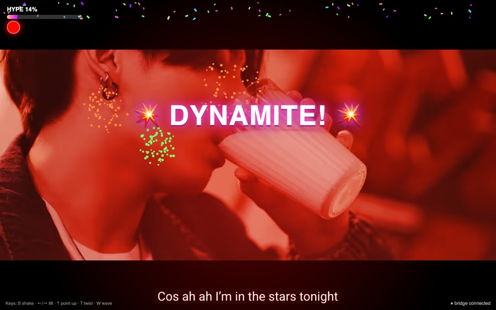

<sub>Shake the wand → <b>💥 DYNAMITE!</b> Fireworks, confetti, screen shake, +15% hype.</sub>

</div>

---

## ✨ What it does

| Gesture | How you do it | 🎆 Concert mode | 📺 Standard mode |
|---|---|---|---|
| **SHAKE** | Shake hard, 3 hits in 0.6 s | Fireworks, confetti, screen shake | Random official BTS video |
| **TILT_LEFT / RIGHT** | Roll 45–95° and hold 0.3 s | Light sweep: *"LEFT SIDE ARMY!"* | Previous / next photo |
| **POINT_UP** | Raise the tip past 70°, hold 1 s | Stage spotlights and rising stars | Latest posts from X |
| **TWIST** | Flick around the long axis (>300°/s) | Rainbow disco swirl | Random member spotlight |
| **WAVE** | Swing it in arcs, lightstick style | A sea of glowing lightsticks synced to your tempo | Fun BTS fact |

Every gesture fills the **HYPE** meter. Hit 100% and the sky erupts: **🎆 ENCORE! 🎆**

In concert mode the wand is also a live **color orb**: roll sets the hue, pitch sets the brightness, streamed from the IMU ten times a second.

## 📸 Concert mode

<table>
  <tr>
    <td>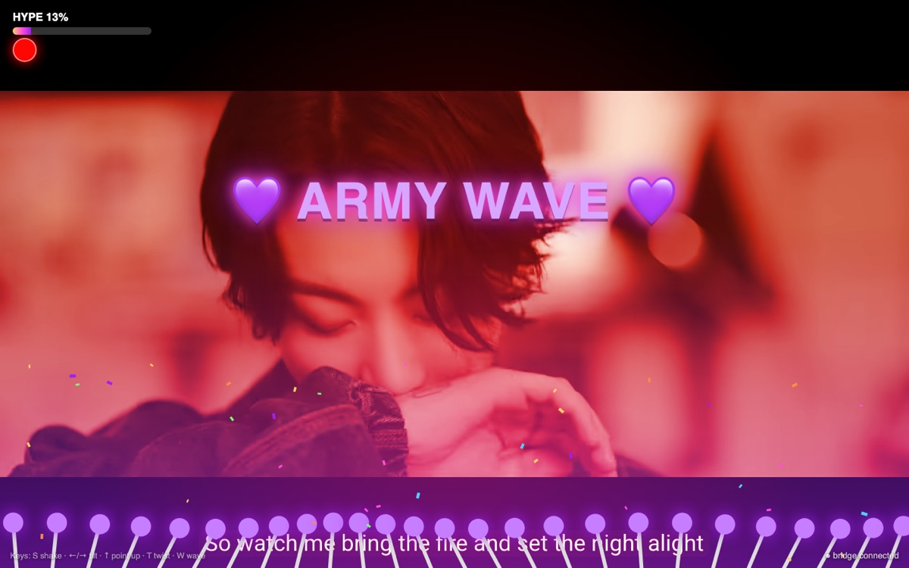</td>
    <td>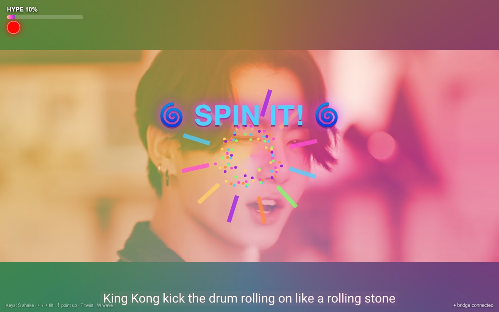</td>
  </tr>
  <tr>
    <td align="center"><b>WAVE</b> · lightsticks sway at your wave tempo</td>
    <td align="center"><b>TWIST</b> · rainbow disco swirl</td>
  </tr>
  <tr>
    <td>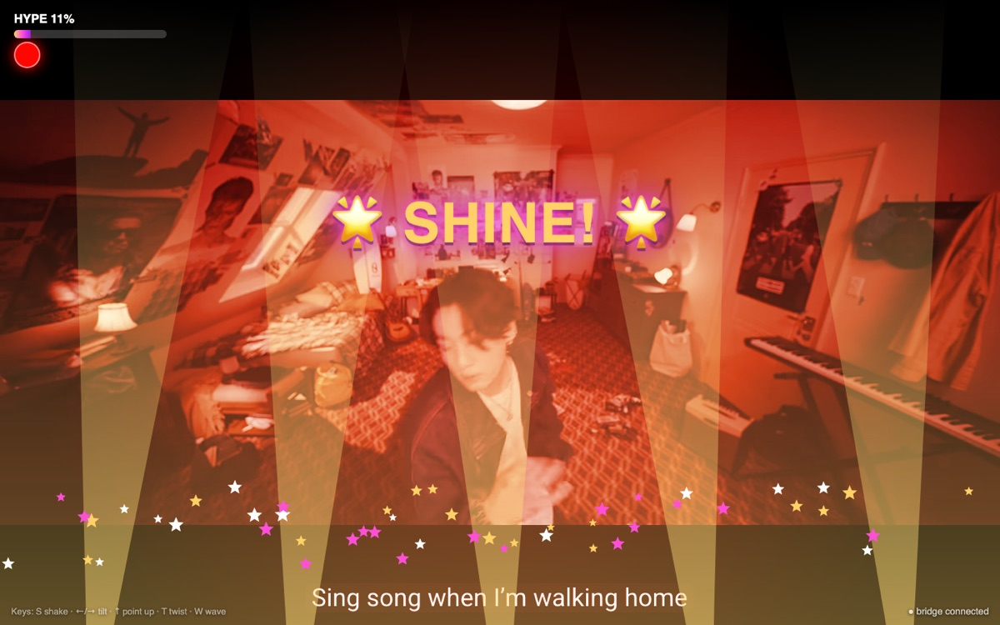</td>
    <td>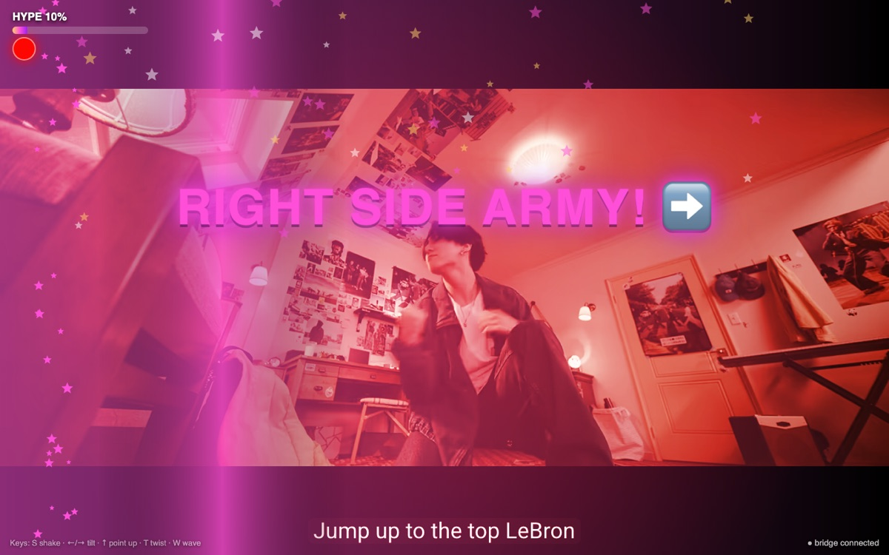</td>
  </tr>
  <tr>
    <td align="center"><b>POINT UP</b> · stage spotlights</td>
    <td align="center"><b>TILT</b> · left side vs right side ARMY</td>
  </tr>
</table>

<p align="center">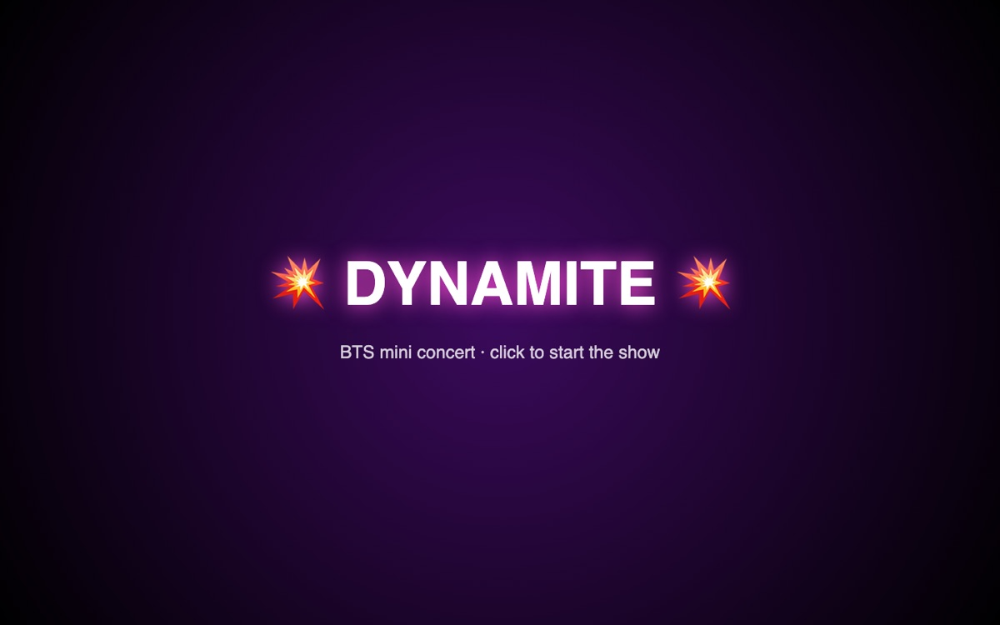</p>

## 📺 Standard mode

<table>
  <tr>
    <td>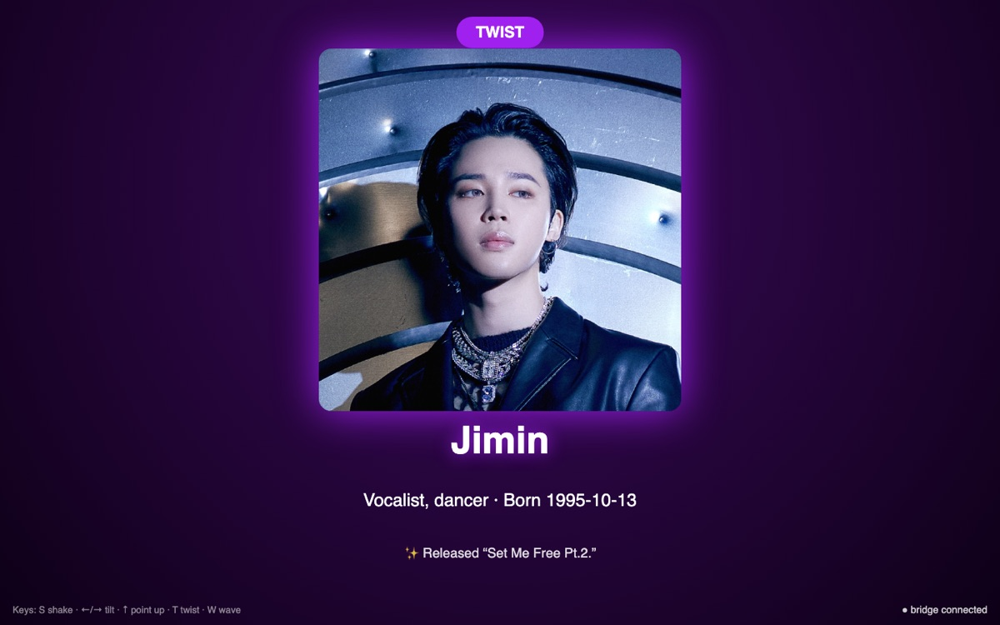</td>
    <td>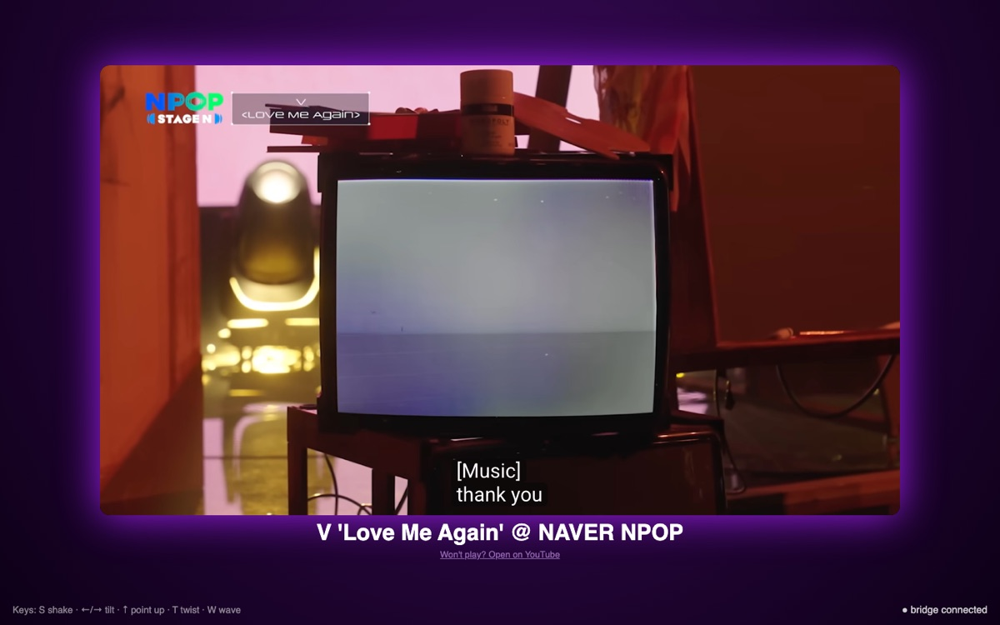</td>
  </tr>
  <tr>
    <td align="center"><b>TWIST</b> · member spotlight</td>
    <td align="center"><b>SHAKE</b> · random official video</td>
  </tr>
  <tr>
    <td>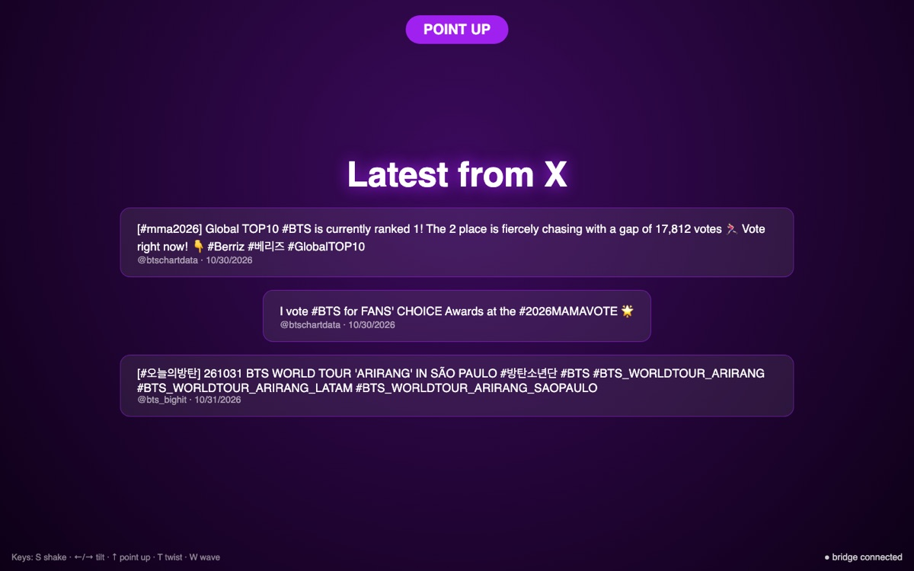</td>
    <td>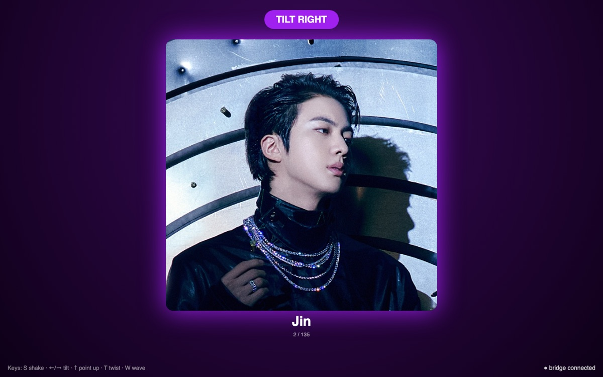</td>
  </tr>
  <tr>
    <td align="center"><b>POINT UP</b> · latest from X</td>
    <td align="center"><b>TILT</b> · photo slideshow</td>
  </tr>
</table>

## 🔧 How it works

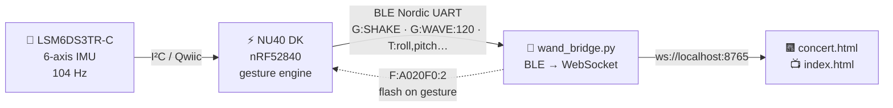

1. **The wand** samples accel + gyro at 104 Hz and runs gesture detection on-chip: peak counting for shakes, held-pose timers for tilt and point-up, a hysteresis swing detector for waves, and per-gesture latches so one long shake fires once.
2. It sends newline-terminated ASCII over **BLE Nordic UART** as `KpopWand`.
3. **`wand_bridge.py`** finds the wand, forwards every line to the browser over WebSocket, and flashes the wand back to confirm each gesture.
4. **The browser** turns gestures into effects. No wand handy? The keyboard works too.

Every threshold was tuned against real recordings of the wand in hand over five rounds of live testing. The full protocol lives in [`KPOP_WAND_SPEC.md`](KPOP_WAND_SPEC.md).

## 🧰 Hardware

| Part | Notes |
|---|---|
| **NUCODE NU40 DK** | nRF52840, 64 MHz Cortex-M4F, BLE 5, native USB |
| **NU-IMU (ST LSM6DS3TR-C)** | 6-axis accel + gyro on the Qwiic connector |
| **Qwiic cable** | No soldering needed |
| **LiPo battery** *(optional)* | Plugs into the BATT connector, reported as `B:<percent>` |
| **A long cardboard box** | Holds the board and sensor aligned. Seriously, that's the wand. |

> The IMU sits at roughly 61° around the long axis inside the box. The firmware rotates the readings (`MOUNT_ROLL_DEG`) so your natural "neutral" hold reads as level. Re-measure yours with the telemetry monitor below.

## 🚀 Quick start

### 1. Flash the wand

```bash
# One time: add the NUCODE board package and install the core
arduino-cli config add board_manager.additional_urls \
  https://raw.githubusercontent.com/Nucode01/Adafruit_nRF52_Arduino/refs/heads/master/package_nuduino_index.json
arduino-cli core update-index && arduino-cli core install nucode:nrf52

# Build and upload (double-press RESET if the port doesn't show up)
arduino-cli compile --fqbn nucode:nrf52:nu40dk firmware/kpop_wand
arduino-cli upload  --fqbn nucode:nrf52:nu40dk -p /dev/cu.usbmodemXXXX firmware/kpop_wand
```

### 2. Start the show

```bash
pip3 install -r laptop/requirements.txt

python3 laptop/wand_bridge.py --concert   # 🎆 concert mode with the real wand
python3 laptop/wand_bridge.py             # 📺 standard mode
python3 laptop/wand_bridge.py --fake      # no wand: type gestures in the terminal
```

The page opens at **http://localhost:8000**. Keyboard fallback: <kbd>S</kbd> shake · <kbd>←</kbd>/<kbd>→</kbd> tilt · <kbd>↑</kbd> point up · <kbd>T</kbd> twist · <kbd>W</kbd> wave.

## 📡 BLE protocol

Device name `KpopWand`, Nordic UART Service `6E400001-B5A3-F393-E0A9-E50E24DCCA9E`, newline-terminated ASCII.

| Direction | Message | Meaning |
|---|---|---|
| wand → laptop | `G:SHAKE`, `G:TILT_LEFT`, `G:TILT_RIGHT`, `G:POINT_UP`, `G:TWIST` | Gesture fired |
| wand → laptop | `G:WAVE:<wavesPerMinute>` | Wave with tempo |
| wand → laptop | `B:<percent>` | Battery, every 30 s |
| wand → laptop | `T:<roll>,<pitch>,<gyroLong>,<gyroZ>,<centi-g>,<gyroY>` | Telemetry at 10 Hz (after `D:1`) |
| laptop → wand | `C:RRGGBB` · `C2:RRGGBB:RRGGBB` | Set color / two-color alternate |
| laptop → wand | `F:RRGGBB:<n>` · `P:<bpm>` · `OFF` | Flash, pulse, off |
| laptop → wand | `D:1` · `D:0` | Telemetry on / off |

## 🎛️ Tuning your wand

Watch the IMU live and see every gesture as it fires:

```bash
python3 tools/wand_monitor.py --telemetry
```

```
roll     0  pitch    -1  gyroLong      2  gyroY     -3  gyroZ     -4  |a| 1.00 g
<< G:TILT_RIGHT
<< G:WAVE:35
```

Every threshold is a named constant at the top of [`kpop_wand.ino`](firmware/kpop_wand/kpop_wand.ino): `SHAKE_G`, `TILT_DEG`, `TWIST_DPS`, `WAVE_SWING_DPS`, and the rest.

## 🗂️ Repo layout

```
firmware/kpop_wand/    nRF52840 firmware: IMU driver, gesture engine, BLE, LEDs
laptop/                wand_bridge.py + concert.html + index.html + BTS content
tools/wand_monitor.py  BLE debug monitor and live telemetry
KPOP_WAND_SPEC.md      shared hardware + protocol spec
docs/screenshots/      the pictures above
```

## 🤝 Built by a two-AI crew

This project was built by two AI agents working in parallel off one shared spec. **Claude Code** wrote the firmware, calibrated the IMU, and tuned the gestures live on the board. **Grok** built the laptop bridge, the concert, and the content.

---

<div align="center">
<sub>Photos, thumbnails, and videos are BIGHIT MUSIC / HYBE material, used here for a non-commercial fan demo. Not affiliated with BTS, BIGHIT MUSIC, or HYBE.</sub><br>
<sub>💜 Borahae 💜</sub>
</div>
